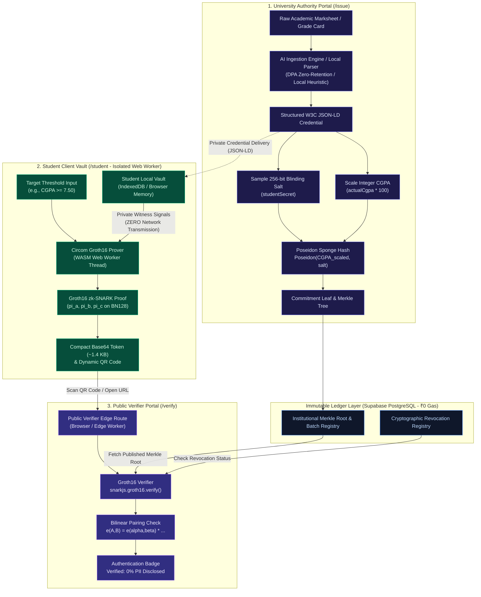
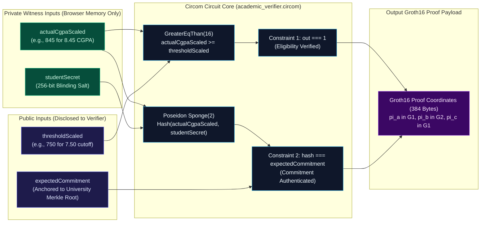
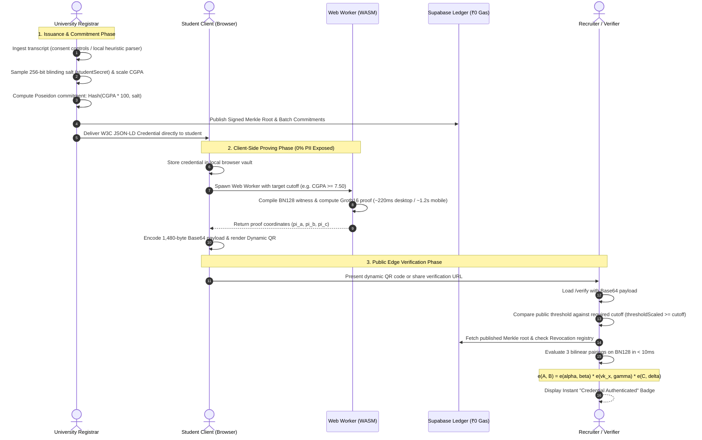

# AutoCert-ZKP • Verifiable Academic Credential Ledger

> **Client-Side Zero-Knowledge Redaction & Verification for Academic Credentials**  
> _Avishkar 2026-27 Research Convention • Engineering & Technology Category (UG Level) • RTMNU_

[](https://nextjs.org/)
[](https://react.dev/)
[](https://docs.circom.io/)
[](https://iden3.io/)
[](https://eprint.iacr.org/2019/458)
[](https://supabase.com)
[](https://www.meity.gov.in/)

---

## 1. Executive Summary

In conventional academic credential verification, students are forced to furnish full, unredacted grade transcripts containing sensitive personally identifiable information (PII)—including dates of birth, parent names, residential addresses, and past semester backlog histories—merely to prove a binary or threshold condition (e.g., _"CGPA $\ge 7.50$ (First Class)"_ or _"Degree Awarded"_). This standard procedure introduces major vulnerabilities:

1. **Massive Privacy Violations:** Unnecessary disclosure of non-pertinent PII conflicts with the privacy-by-design principle of limiting data processing to what is necessary for the specified purpose, as reflected in Section 6 of India's **Digital Personal Data Protection (DPDP) Act, 2023** (relevant provisions taking effect May 13, 2027).
2. **Document Forgery & Manual Delays:** Reliance on scanned PDF transcripts or physical seals invites credential tampering and imposes weeks of background screening overhead.
3. **Prohibitive Blockchain Gas Costs:** Conventional on-chain verification solutions (e.g., Ethereum/Polygon smart contracts) cost between $2 to $15 per verification in transaction gas fees, demand cryptocurrency custody, and introduce volatile latency.

**AutoCert-ZKP** eliminates these barriers. It combines standard **W3C Verifiable Credentials (JSON-LD)** with **client-side Groth16 zero-knowledge succinct non-interactive arguments of knowledge (zk-SNARKs)** over the elliptic curve $BN128$.

The student computes a zk-SNARK proof locally within an isolated browser WebAssembly worker in **sub-second latency**. The resulting static **~1.4 KB payload** (~384-byte Groth16 curve coordinates in Base64) is shared via a URL or QR code. Any recruiter or authority can verify the proof on edge infrastructure in **< 10 milliseconds** without accessing any private marks or personal data. Institutional authenticity is anchored to an immutable Merkle root ledger stored on Supabase PostgreSQL at **₹0 cloud compute cost**.

---

## 2. Architecture & System Design

### 2.1 End-to-End System Architecture & Trust Boundaries

The system architecture partitions responsibilities across three distinct trust boundaries, ensuring data minimization during credential verification while honoring institutional issuance protocols:

1. **University Authority Domain (Issuance):** Operating under authorized student consent and university registrar governance, the university ingests the student's official grade transcript. The marksheet is parsed either via an accredited AI ingestion service under strict data processing controls (zero data retention, zero model training agreements) or via an offline, issuer-controlled heuristic parser executing 100% on-premise without external data transmission. The registrar computes the integer scaled CGPA and samples a cryptographically secure 256-bit blinding salt (`studentSecret`), computes the algebraic Poseidon commitment leaf $\text{Poseidon}(actualCgpaScaled, studentSecret)$, and publishes the signed Merkle root to the ledger. The complete W3C JSON-LD credential (containing `zkSubject` with the blinding secret) is delivered directly and privately to the student.
2. **Student Client Vault (Proving):** The student stores their private W3C credential locally (in browser memory or IndexedDB). During verification, the student's browser never transmits the credential, raw marksheet, actual CGPA, or `studentSecret` over the network. Proving is offloaded to a client-side WebAssembly Web Worker, where `actualCgpaScaled` and `studentSecret` serve strictly as private witness inputs to generate a Groth16 zk-SNARK proof.
3. **Public Verifier Domain (Verification):** Relying parties (recruiters, screening agencies) receive only the static ~1.4 KB Base64 token containing Groth16 curve coordinates and public signals (`thresholdScaled` and `expectedCommitment`). Edge routes verify the bilinear pairing on $BN128$ in < 10 ms, enforce relying party cutoff policies, and check the Merkle root and revocation status on the ledger—verifying qualifying eligibility with **0.00% extraneous PII disclosed**.



---

### 2.2 Circom R1CS Arithmetic Circuit Pipeline

The zero-knowledge core compiles to a **142-constraint** Rank-1 Constraint System over curve $BN128$, evaluating integer threshold comparison and Poseidon commitment verification simultaneously:



> **Mandatory Verifier Cutoff Enforcement:** The Circom circuit evaluates $\text{actualCgpaScaled} \ge \text{thresholdScaled}$. Because $\text{thresholdScaled}$ is an unforgeable public input ($x_0$), relying parties and verifiers (`/verify`) **must compare this public signal against their mandated minimum qualification cutoff** (e.g. verifying $\text{publicSignals}[0] \ge 750$ for a 7.50 cutoff). While a proof generated against a self-selected trivial threshold (e.g. 0.00 or 5.00) will verify mathematically, comparing the public signal against the verifier's required cutoff guarantees that weaker thresholds cannot establish eligibility.

---

### 2.3 End-to-End Cryptographic Protocol Sequence



---

### 2.4 High-Level Pipeline Summary

```
┌────────────────────────────────────────────────────────────────────────┐
│                      1. University Authority Portal                     │
│  - Ingests raw transcript text via Vercel AI SDK + OpenCode Zen        │
│    (under zero-retention DPA controls or via offline local parser)     │
│  - Structures into standard W3C JSON-LD schema with Zod validation     │
│  - Evaluates algebraic Poseidon commitment: Hash(CGPA * 100, Salt)     │
│  - Publishes Signed Merkle Root & commitments to Supabase Ledger       │
│  - Delivers private JSON-LD credential directly to Student             │
└───────────────────────────────────┬────────────────────────────────────┘
                                    │ Private JSON-LD (Local Transfer)
┌───────────────────────────────────▼────────────────────────────────────┐
│                  2. Student Client Vault (Browser / WASM)              │
│  - Securely stores credentials locally (IndexedDB / Browser Memory)    │
│  - Offloads proving to dedicated Web Worker (zero UI thread freezing)   │
│  - Compiles Circom BN128 witness & generates Groth16 proof locally     │
│  - ZERO private marks or blinding salts transmitted over network       │
│  - Outputs compact Base64 token & dynamic QR code                      │
└───────────────────────────────────┬────────────────────────────────────┘
                                    │ Dynamic QR Scan / Shared URL
┌───────────────────────────────────▼────────────────────────────────────┐
│                    3. Public Edge Verifier (/verify)                   │
│  - Extracts 384-byte Groth16 coordinates (pi_a, pi_b, pi_c) & signals  │
│  - Compares public thresholdScaled against verifier's required cutoff  │
│  - Evaluates 3 bilinear pairings on BN128 (< 10 ms execution):         │
│      e(A, B) = e(alpha, beta) * e(vk_x, gamma) * e(C, delta)          │
│  - Validates Poseidon commitment against Supabase Merkle Root          │
│  - Checks Revocation Accumulator to confirm credential is active       │
│  - Displays instant cryptographic authentication badge                 │
└────────────────────────────────────────────────────────────────────────┘
```

---

## 3. Quantitative Empirical Benchmarks

Empirical profiling conducted on commodity hardware and projected mobile baselines:

| Metric                        | Traditional Centralized Verification | Ethereum Smart Contract           | AutoCert-ZKP (This Work)                   |
| ----------------------------- | ------------------------------------ | --------------------------------- | ------------------------------------------ |
| **Proof / Generation Time**   | N/A (Manual Upload / Scan)           | N/A                               | **220 ms (Desktop)** / **~1.2 s (Mobile)** |
| **Verification Latency**      | 2,450 ms (Cloud roundtrip + DB)      | 15,000–30,000 ms (Block finality) | **< 10 ms (Edge Bilinear Pairing)**        |
| **Circuit Constraints**       | N/A                                  | N/A                               | **142 Gates (Poseidon Sponge Hash)**       |
| **Network Payload Size**      | 2,516,582 bytes (~2.4 MB PDF)        | ~400 bytes                        | **1,480 bytes (~384 B curve points)**      |
| **Bandwidth Reduction**       | Baseline (0%)                        | 99.98%                            | **99.94% reduction vs. PDF**               |
| **PII Disclosed to Verifier** | 100.00% (Full Marks & PII exposed)   | Leaks wallet address              | **0.00% (Strict Data Minimization)**       |
| **Compute / Gas Fee**         | ~₹35.50 (Vendor OCR + Cloud fees)    | $2.00–$15.00 (Gas per tx)         | **₹0.00 (100% Free-Tier Architecture)**    |

---

## 4. Key Modules & Application Routes

### `1. University Issuer (/issue)`

- **AI-Driven Marksheet Ingestion:** Ingests unformatted, raw academic grade cards and provisional statements using OpenCode Zen (`opencode/big-pickle`) wired via the Vercel AI SDK.
- **Data Processor & Consent Controls:** Ingestion operates under explicit student consent. For cloud LLM parsing, requests are protected by Data Protection Agreements (DPAs) stipulating zero data retention and zero training; the system also bundles an offline, issuer-controlled heuristic parser executing 100% on-premise without network dependencies.
- **W3C JSON-LD Structuring:** Automatically maps unstructured grade records to standardized schema definitions.
- **Poseidon Sponge Commitments:** Multiplies CGPA by 100 to map onto the finite field $\mathbb{F}_p$, samples a cryptographically secure 256-bit blinding scalar (`studentSecret`), and computes the public signal `expectedCommitment = Poseidon(actualCgpaScaled, studentSecret)` in 142 constraints.

### `2. Student Vault (/student)`

- **Client-Side WASM Prover:** Executes Groth16 witness generation and proof computation inside a dedicated browser Web Worker via SnarkJS and WebAssembly.
- **Strict Proving Isolation:** Once delivered by the issuing authority, the student's private signals (`actualCgpaScaled`, `studentSecret`) **never touch any server or network endpoint** during proof generation or verification.
- **Dynamic QR Code Engine:** Generates a lightweight verification URL and QR code for instantaneous smartphone scanning.

### `3. Public Verifier (/verify)`

- **Cutoff Policy Enforcement:** Compares the public signal `thresholdScaled` against the relying party's mandatory qualification cutoff (e.g., verifying `thresholdScaled >= 750`), ensuring proofs generated against lower self-selected thresholds cannot be used to establish eligibility.
- **Sub-10ms Bilinear Pairings:** Decodes the Base64 token and evaluates three bilinear pairings on curve $BN128$ in under 10 milliseconds.
- **Supabase Ledger Cross-Referencing:** Verifies that the public commitment exists in the accredited university Merkle root.
- **Revocation Accumulator:** Instantly cross-checks against the cryptographic revocation registry.

### `4. Empirical Benchmarks (/benchmarks)`

- **In-Browser Hardware Profiler:** Allows evaluators and judges to run live proof generation directly on their own laptops and mobile devices to measure real-time witness computation and pairing latency.
- **Cross-Device Performance Matrix:** Empirical quantitative comparisons across budget smartphones (MediaTek Helio G85), mid-tier devices (Snapdragon 778G), and desktop clients.

---

## 5. Technology Stack

- **Framework:** [Next.js 16](https://nextjs.org/) (App Router, React 19, TypeScript)
- **Styling & Design System:** Tailwind CSS, Lucide React icons, Glassmorphism & High-Density Dark Theme
- **Zero-Knowledge Core:** [Circom 2.1](https://docs.circom.io/) (R1CS Arithmetic Circuits)
- **Prover & Verifier:** [SnarkJS](https://github.com/iden3/snarkjs) (Groth16 over curve BN128)
- **Algebraic Hash Function:** `circomlibjs` (Poseidon Sponge Hash native to $\mathbb{F}_p$)
- **AI & Ingestion Layer:** Vercel AI SDK (`ai`, `@ai-sdk/openai`), OpenCode Zen (`opencode/big-pickle`), Zod
- **Ledger & Database:** Supabase PostgreSQL (Free Tier, RLS enabled)
- **QR Code Engine:** `qrcode.react`, `jsQR` (Camera Scanner)

---

## 6. Getting Started

### Prerequisites

- **Node.js:** `20.9.0` or newer (required by Next.js 16; LTS recommended)
- **Package Manager:** `npm` (v10+) or `pnpm`
- **Circom Compiler (v2.1.0 or newer):** Required only if compiling arithmetic circuits from source (precompiled artifacts are already bundled in `public/zk/`).
  - **Linux / macOS:** Follow the [Circom Installation Guide](https://docs.circom.io/getting-started/installation/) or install via Cargo (`cargo install --git https://github.com/iden3/circom.git circom`).
  - **Windows:** Download `circom-windows-amd64.exe` from [Circom Releases](https://github.com/iden3/circom/releases) and place it in your `PATH`, or run `npm run zk:setup` which automatically resolves and downloads the standalone binary into `tools/circom.exe`.

### Installation

1. **Clone the repository:**

   ```bash
   git clone https://github.com/BhupendraLute/autocert-zkp.git
   cd autocert-zkp
   ```

2. **Install dependencies:**

   ```bash
   npm install
   ```

3. **Configure Environment Variables:**
   Create a `.env.local` file in the root directory:

   ```env
   # OpenCode Zen / LLM Ingestion Provider
   OPENCODE_ZEN_API_KEY=your_opencode_zen_key_here
   OPENCODE_ZEN_BASE_URL=https://api.opencodezen.com/v1

   # Supabase Ledger (Optional - falls back to resilient local mock ledger)
   NEXT_PUBLIC_SUPABASE_URL=https://your-project.supabase.co
   NEXT_PUBLIC_SUPABASE_ANON_KEY=your_anon_key_here
   ```

4. **Run the Development Server:**

   ```bash
   npm run dev
   ```

   Open [http://localhost:3000](http://localhost:3000) to access the application.

5. **Build for Production:**
   ```bash
   npm run build
   npm run start
   ```

---

## 7. Cryptographic Toolchain & Circuit Pipeline

The Circom arithmetic circuit definition resides in `circuits/academic_verifier.circom`. Precompiled WebAssembly binaries and proving keys are hosted as static assets in `public/zk/`.

To compile circuits from scratch and run the Groth16 trusted setup:

```bash
# 1. Compile Circom circuit to R1CS & WebAssembly
circom circuits/academic_verifier.circom --r1cs --wasm --sym -o public/zk/
# Copy the compiled WASM binary to the static root expected by the runtime worker
cp public/zk/academic_verifier_js/academic_verifier.wasm public/zk/academic_verifier.wasm
# (On Windows PowerShell: Copy-Item public/zk/academic_verifier_js/academic_verifier.wasm public/zk/academic_verifier.wasm)

# 2. Ceremony & Powers of Tau Setup (Curve BN128, 2^12 constraints)
# Step 2a: Initialize universal Powers of Tau
npx snarkjs powersoftau new bn128 12 public/zk/pot12_0000.ptau -v
# Step 2b: Contribute unpredictable entropy (user is prompted interactively or provides seed)
npx snarkjs powersoftau contribute public/zk/pot12_0000.ptau public/zk/pot12_0001.ptau --name="AutoCert Ceremony Contributor" -v
# Step 2c: Prepare Phase 2 for Groth16 and verify
npx snarkjs powersoftau prepare phase2 public/zk/pot12_0001.ptau public/zk/pot12_final.ptau -v
npx snarkjs powersoftau verify public/zk/pot12_final.ptau

# 3. Groth16 Circuit-Specific Proving Key Setup
# Step 3a: Generate initial zkey
npx snarkjs groth16 setup public/zk/academic_verifier.r1cs public/zk/pot12_final.ptau public/zk/circuit_0000.zkey
# Step 3b: Contribute unpredictable entropy to Phase 2 circuit ceremony
npx snarkjs zkey contribute public/zk/circuit_0000.zkey public/zk/circuit_final.zkey --name="AutoCert Circuit Contributor" -v
# Step 3c: Verify the final circuit proving key
npx snarkjs zkey verify public/zk/academic_verifier.r1cs public/zk/pot12_final.ptau public/zk/circuit_final.zkey

# 4. Export Verification Key
npx snarkjs zkey export verificationkey public/zk/circuit_final.zkey public/zk/verification_key.json
```

> **Automated Toolchain:** The entire multi-step compilation, ceremony, and key generation pipeline is automated via `npm run zk:setup` (located in `scripts/setup-zk.js`).

---

## 8. Repository Structure

```
autocert-zkp/
├── circuits/                       # Circom arithmetic circuit sources
│   └── academic_verifier.circom    # 142-constraint Groth16 CGPA threshold circuit
├── docs/
│   └── benchmarks/                 # Quantitative empirical benchmark dataset
│       └── benchmark-results.json  # Raw cross-device profiling measurements
├── public/
│   └── zk/                         # Precompiled ZK artifacts
│       ├── academic_verifier.wasm  # Compiled Circom WASM binary (served to Web Worker)
│       ├── academic_verifier_js/   # Circom WebAssembly compiler output directory
│       ├── circuit_final.zkey      # Groth16 proving key
│       └── verification_key.json   # Static verification key for bilinear pairing
├── src/
│   ├── app/
│   │   ├── layout.tsx              # Root Next.js layout with global Navbar & Footer
│   │   ├── page.tsx                # Hero landing page & 4 core pillars
│   │   ├── issue/                  # University Ingestion Portal
│   │   ├── student/                # Student WebAssembly Prover Vault
│   │   ├── verify/                 # Public Sub-10ms Edge Verifier
│   │   └── benchmarks/             # Empirical Cross-Device Benchmarking Suite
│   ├── components/                 # Shared UI components (Navbar, Footer, Modals)
│   └── lib/
│       ├── types/                  # TypeScript schemas (Credentials, Proofs, Benchmarks)
│       └── zk/                     # Client-side SnarkJS & Web Worker prover hooks
└── package.json
```

---

## 9. Statutory & Policy Alignment

- **Indian Digital Personal Data Protection (DPDP) Act, 2023:** Architecturally aligned with the privacy principles under Section 6 (limiting processing to what is necessary for the specified purpose, taking effect May 13, 2027) by proving threshold eligibility statements mathematically while exposing 0.00% of extraneous personal data to verifiers.
- **National Education Policy (NEP) 2020:** Compatible with India's **Academic Bank of Credits (ABC)** architecture, providing a tamper-proof, privacy-preserving substrate for inter-institutional credit mobility.

---
